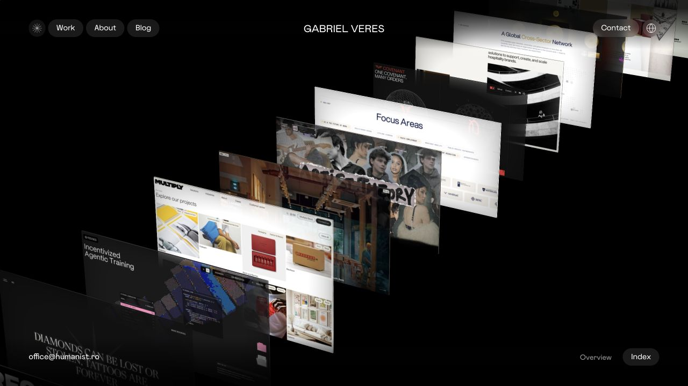
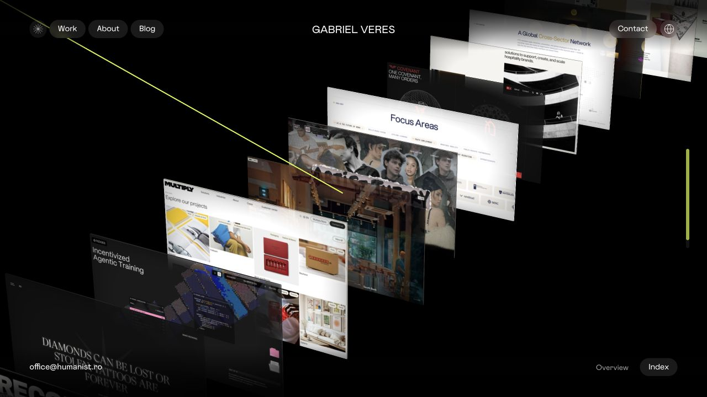
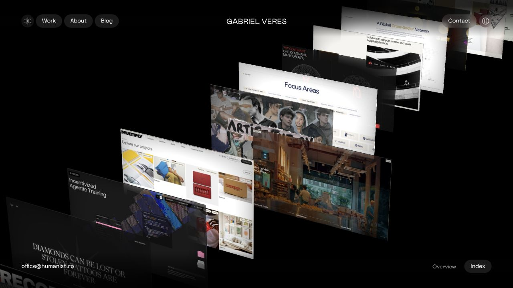
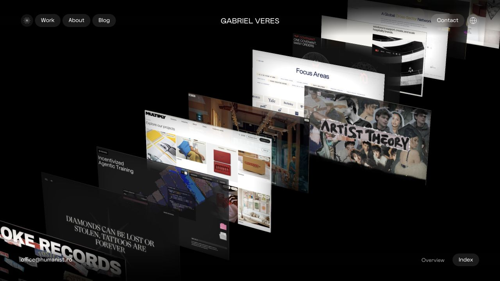

# Work gallery reference audit

15 November 2026 · Gabriel Veres Overview at `/` · Vivaan Surti portfolio working tree

## 1. Verified reference behaviour and frontend

The Overview is a viewport-sized Three.js scene inside a Next.js / React page. In the live browser at **1280 × 720 CSS px, DPR 2**, the Overview section contained one `canvas[data-engine="three.js r149"]`, sized 1280 × 720 CSS px and backed by 2560 × 1440 pixels. Individual project surfaces were absent from the DOM. The header, email link and view navigation were DOM overlays. The gallery's black field was the computed background of `main`. The body behind it had a lime background.

| Technology | Gallery-specific evidence |
| --- | --- |
| React / Next.js | App Router chunks loaded by the live document. Home bundle module 14619 renders `ProjectsOverview`, the route controls and the scene. |
| Three.js / WebGL | Live canvas marker and browser-served Three.js r149 bundle. The scene uses shared thin box geometry, textured meshes, a perspective camera and a WebGL renderer. |
| React Three Fiber | Home imports Canvas and the per-frame hook from runtime modules 17462 and 96474. Those modules create the Three renderer, reconcile React mesh/group elements, provide the default camera and subscribe the frame callback. |
| Custom GLSL | The home bundle passes a UV vertex shader and a texture/alpha fragment shader to the visible mesh. |
| GSAP | Used by the instantiated custom cursor through its GSAP adapter. Gallery mesh hover and intro use the motion-value animation helper imported from chunk 7146. Scene travel is interpolated in the Fiber frame callback. |
| ScrollTrigger | No ScrollTrigger dependency was identified in the traced Overview component, its scroll input module or its movement callback. A `lenis` class is present on the live root, while Overview uses its own accumulator. |

I inspected the running site in the in-app browser after the Chrome DevTools connector found no Chrome Stable executable. I matched the document's public asset URLs to the minified bundles and CSS and followed the relevant imports by module ID. The inspected home and runtime bundles did not advertise a `sourceMappingURL`. Two other page dependencies timed out during asset retrieval. Findings below are scoped to the traced gallery path. [Live Overview](https://www.gabrielveres.com/), [home bundle](https://www.gabrielveres.com/_next/static/chunks/app/(pages)/page-cf18af1cb4ffbb6c.js), [Fiber and sizing chunk](https://www.gabrielveres.com/_next/static/chunks/4183-ca232ff34534d18a.js), [input and animation chunk](https://www.gabrielveres.com/_next/static/chunks/7146-084c1021708c4bc7.js), [cursor adapter and transition router](https://www.gabrielveres.com/_next/static/chunks/1363-5b76464af571e241.js), [Three.js chunk](https://www.gabrielveres.com/_next/static/chunks/b536a0f1-f6830016c1fcd328.js), [site stylesheet](https://www.gabrielveres.com/_next/static/css/15304164d195698e.css)

## 2. Inferred visual effects

The panels read as light because their images contribute unevenly across each surface. A bright center stays readable, edges over black lose contrast, and edges over other projects admit the underlying artwork. The two large black wedges leave each silhouette legible and make the diagonal feel suspended. Keep both wedges when tuning coverage.

The lineup appears irregular even though the underlying strip has regular spacing. The oblique projection produces unequal screen gaps, the source aspect ratios change the dimensions of individual panels, and a hovered panel can move well away from the strip. For instance, the Future Talent Council panel in the supplied reference frame sits well to the right of its resting position in the live baseline, and its title is visible. Those cues are consistent with the verified hover displacement. The screenshot alone cannot establish its scroll offset or the exact point in the hover tween.

Some edges show a fine glint. The visible mesh is a thin box, and antialiasing and high-contrast transitions can contribute to that appearance. The traced material contains no separate rim-light term, edge stroke, or lighting calculation. A restrained edge accent would be a recreation choice if comparisons show it is needed.

## 3. Material and transparency

| Question | Evidence |
| --- | --- |
| Genuine alpha? | Yes. The visible material enables transparency and disables depth writes. It samples the texture's RGB and computes fragment alpha independently from the texture's alpha channel. At the UV boundary the shader outputs 0.75 alpha. Alpha rises in a soft rectangular vignette toward the center. The authored expression exceeds 1 at the center, so its numbers should not be described as a strict 75–100% interpolation over the whole surface. |
| Can you see the project behind? | Yes. The red Covenant artwork reappears faintly through the upper part of the light Future Talent Council panel in the captured baseline. Background texture detail remains recognizable at other overlaps. The effect depends on both local opacity and the colors of the two projects. |
| Depth or scroll fade? | The shader takes a texture uniform and UV coordinates. It receives no time, camera-distance, depth-fade, scroll or hover parameter. A given point on the image keeps its authored alpha as it travels. The overlap and sampling change with projection, which changes apparent translucency. |
| Blur? | The fragment shader samples its own texture once. There is no background sample or blur kernel in that shader, and the inspected canvas and ancestors compute to `filter: none` and `backdrop-filter: none`. The route bundle requests 500-pixel-wide project textures, so ordinary texture filtering and limited source resolution can soften detail. Header and Index chrome separately use CSS backdrop blur. |
| Highlights and grain? | No explicit highlight or grain term appears in the visible panel shader. Its RGB comes directly from the source sample. Visible stipple could come from the artwork, resampling, or capture compression. These frames do not isolate those causes. No animated panel-grain mechanism was identified in the traced shader. |
| Hit area? | Each project also has an invisible interaction mesh. Its opacity/visibility settings are independent of the image shader. Changing the hit mesh's material would have no effect on the visible artwork. |

## 4. Camera, positioning and measured footprint

The desktop camera is a perspective camera at world coordinates **(-5.9, 3, 3.4)** with a **15° vertical FOV**, near/far **0.1 / 20**, and the Fiber runtime's default look-at toward the origin. This is roughly **24° elevation** and an oblique view of the faces. All panels share a **−90° Y rotation** in the scene. There is no authored per-project roll. The photographed tilt comes from the camera and perspective. Default resting panel centers lie along world X with adjacent slots about **0.53 world units** apart. The camera's negative X makes the lower-left portion of the strip nearer to it. The thin boxes use native image aspect ratios, scaled from a camera-viewport fit with a **0.275** desktop factor and **0.255** below the reference's 1024 px breakpoint. The factor is applied in scene units. It is distinct from a CSS width of 27.5vw.

Approximate hand-read top-edge endpoints in the settled **1280 × 720** frame. Width is the horizontal span of the edge, including portions visible through overlap. Fragments clipped by the viewport are only lower bounds. Angles measure the projected top edge down toward screen right.

| Region / example | Top left → top right, CSS px | Width | Slope |
| --- | --- | --- | --- |
| Near, Ridges | (152, 430) → (500, 524) | 348 px / 27% | 15° |
| Near-mid, Multiply | (286, 330) → (621, 408) | 335 px / 26% | 13° |
| Mid, Common Thread image | (407, 281) → (725, 350) | 318 px / 25% | 12° |
| Mid, Artist Theory | (514, 218) → (822, 277) | 308 px / 24% | 11° |
| Mid, Future Talent Council | (585, 162) → (933, 228) | 348 px / 27% | 11° |
| Far-mid, Covenant | (695, 117) → (~980, ~171) | ~285 px / 22% | ~11° |
| Far, white hospitality artwork | (773, 68) → (~1049, ~115) | ~276 px / 22% | ~10° |
| Far, white network artwork | (844, 20) → (~1114, ~64) | ~270 px / 21% | ~9° |

About **10–12 discernible surfaces** span the shot, including clipped fragments at both ends. This is a count of visible artwork, with ambiguity in the far-right overlaps. The successive top-left steps in the measured segment range from **71–134 px right** and **45–100 px up**. Apparent widths are broadly smaller in back, with aspect-driven exceptions such as Future Talent Council. Near the middle, Multiply and the Common Thread artwork share about **214 px of horizontal span**, and Common Thread and Artist Theory share about **211 px**. Their true overlapping polygons occupy only part of those spans. The overlapping near images cover the lower parts of the farther images. The image row occupies a narrow northeast–southwest band with open upper-left and lower-right wedges.

In the supplied, wider reference attachment (2672 × 1332 recorded pixels), Multiply and Artist Theory span roughly **26%** and **24%** of frame width, consistent with the live measurement. The supplied local frame (2664 × 1350 recorded pixels) places Chapters & Co. at roughly **36%**, Obby **32%**, psych **30%**, Mochila **28%** and Helios **27%** by their top edges. The local foreground and center are particularly oversized. The local top edges also sit near **2–6°** for most readable cards, versus roughly **9–15°** in the live reference. This cross-attachment comparison is normalized for size. It compares different artwork and does not assume matching hover or scroll state.

## 5. Animation and route behaviour

| Interaction | Live observation | Public bundle evidence |
| --- | --- | --- |
| Scroll and inertia | The scene moved while document `scrollY` stayed 0. A frame immediately after input and a later frame showed distinct positions. Several inputs advanced the composition farther toward the lower-left artworks. | Wheel/touch/keyboard virtual scroll accumulates an input value. The Fiber tick moves a parent group along world X, approaching its latest target by 10% of the remaining difference per frame. Camera options are static in this path. The smoothing is frame-dependent. |
| Entry | The baseline frame was taken after the initial position settled. I did not time the loader from the browser captures. | When the last texture reports loaded, a separate parent group animates its X position over 2 s after a 0.2 s delay. A loading progress overlay also uses motion values. |
| Hover | The artwork slides out of the diagonal. Compare Common Thread in the baseline and settled hover frame, and Artist Theory in the farther frame. The supplied screenshot also shows the project name beside the pointer. | The invisible mesh drives the custom cursor text and animates the visible mesh's world Z from 0 to 0.65 with a 0.5 s enter and 0.35 s return. It leaves the scale and material unchanged. The oblique camera projects that Z motion into the prominent sideways displacement. Desktop hover also calls a sound helper. Audio playback was not independently verified. |
| Pointer response | Cursor graphics respond to pointer movement. The image that moves prominently is the hovered image. | No pointer-to-camera coupling was found in the Overview path. The pointer affects hit tests, the cursor, and the hovered mesh. |
| Click | Clicking the Multiply surface opened `/projects/multiply`. A captured frame immediately after input still showed the outgoing Overview, followed by the project hero. | The click starts a route transition. The View Transition callback fades and shifts the **old root** upward and reveals the **new root** with a vertical clip, with a 1.2 s duration. No click-to-center or per-project zoom appears in the traced click path. |
| Overview / Index | Index opened `/projects`, with project links in a multi-column list. Browser Back returned to Overview. | Overview's active label is text. Index is a route link and uses the same root-transition callback. |
| Loop and endpoints | Multiple inputs traversed additional artwork. A complete wrap in both directions was not captured. | The slot list rotates in either direction after crossing a spacing threshold and wraps data indexes modulo item count. This is a loop with recycled project slots. The code specifies no terminal stop. |
| Light / dark | Overview and Index were both black in the tested states. Clicking the globe exposed the clock without changing the palette. Scrolling Overview did not produce a light state. | The backdrop is set by the black utility on `main`. The inspected Overview scroll callback changes world X and recycles panels. No light/dark control or scroll-to-theme branch was identified for the gallery. Other routes were outside the theme audit beyond the Multiply click and brief scroll. |

[Overview](https://www.gabrielveres.com/), [Index](https://www.gabrielveres.com/projects), [Multiply detail](https://www.gabrielveres.com/projects/multiply), [Overview implementation](https://www.gabrielveres.com/_next/static/chunks/app/(pages)/page-cf18af1cb4ffbb6c.js)

[Captured Index list](work-gallery-reference-audit/idx.jpg) · [Captured Multiply project destination](work-gallery-reference-audit/detail.jpg)

## 6. Local implementation and causes

| Area | Current working tree | Effect on the comparison |
| --- | --- | --- |
| Renderer and depth | [work-overview.js](../foundation/work-overview.js#L8) and [work-overview.css](../foundation/work-overview.css#L7) use transformed DOM anchors under centered **1100 px CSS perspective** with `preserve-3d`. Initial Z runs from **+225 px to −511 px** over nine slots in **92 px** steps, with a travel-time clamp of **−870 to +465 px**. | This is meaningful CSS depth. At initial rest the approximate center projection factors are **1.26×** in front and **0.68×** in back. The primary issue is how depth is mapped to the screen. |
| Position and pose | [point and draw](../foundation/work-overview.js#L60) prescribe X and Y in viewport fractions, then multiply both offsets by `1 - z / perspective`, cancelling the perspective scale for the **centers**. Desktop steps are .118W and −.106H with a quadratic X bend and per-index nudges. The angles are driven by 5.5° roll, −2.5° pitch and a modest position-dependent yaw built around −12°. | A screen-space diagonal stays regular as cards travel. There is some per-card variation, but the constant-height/width card geometry and common roll visually dominate. The reference's screen positions and angles arise from a coherent oblique camera and source-aspect variation. |
| Size and framing | [Card size rule](../foundation/work-overview.css#L14) is `clamp(260px, min(32vw, 63svh), 780px)`, with a 16:10 aspect and cover fit. At a hypothetical matching 1280 × 720 layout, the starting width is **410 CSS px**. Ignoring rotation, depth projects the first slot to **515 px (40%W)**, slot 2 to **425 px (33%W)**, slot 4 to **363 px (28%W)**, and slot 8 to **280 px (22%W)**. These are analytic center-plane estimates before clipping or rotation. | Oversizing is strongest at the near end. Several cards occlude most of the next one, and their shallow top edges read as large screenshots sliding over one another. Shrinking the same rectangle uniformly would leave the screen-space trajectory and opaque compositing in place. |
| Material | [Surface and artwork rules](../foundation/work-overview.css#L14) paint an opaque `#141414` anchor and a full-cover, fully opaque image. All nine Overview WebPs are **1120 × 700**, VP8 with no alpha. The 14% white outline is its own layer. Opacity animation in [select](../foundation/work-overview.js#L115) fades the entire mode, and the per-card opacity rule controls the hover label. | There is no continuous artwork transparency. Reducing only the image's opacity would expose its dark backing. The entire rendered art surface, including its backing if retained, must contribute alpha to the stack. The label and focus treatment need independent visibility. |
| Scroll clock and hover | [work.js](../foundation/work.js#L53) maps the sticky section's native scroll into finite progress, uses an 80 ms time-based exponential easing, and delegates painting to Overview when selected. Overview sweeps **7.1 slots** over about **5.05 viewport heights** of pinned travel and transforms every card on each changed frame. Hover is CSS outline/label only. Keyboard focus can recenter a panel. [Click](../foundation/work-overview.js#L165) animates the panel to centered, straight-on Z = 365 over **390 ms** before navigating. | Local inertia already exists. Mode changes crossfade outgoing/incoming DOM in **155 / 360 ms** while preserving normalized pinned scroll where possible. Its hover and click choreography differ substantially from the reference. |
| Theme and navigation | [ambient.js](../foundation/ambient.js#L14) toggles and persists the root `data-theme` under `portfolio-theme`. [style.css](../foundation/style.css#L1) provides root palette variables, [work.css](../foundation/work.css#L5) provides Index background/shell/shadow tokens, and the Overview hardcodes its black palette. [index.html](../index.html#L111) mounts two views inside one sticky Work section. [work.js](../foundation/work.js#L156) owns in-page hash navigation and the gallery skip calculation. [navigation.js](../foundation/navigation.js#L1) tracks the current section separately. [projects.js](../foundation/projects.js#L40) resolves real project pages and appends `index.html` for file URLs. | Local Index is a capsule, repeated WORK lettering and staggered cards, with no equivalent of the reference's editorial list. Theme state changes the surrounding portfolio and Index, while Overview stays near-black. Work links target `#work` and project links open standalone documents. |
| Assets and overhead | [projects.js](../foundation/projects.js#L10) supplies nine dedicated Overview captures (JobScroll, Amora, Chapters & Co., Obby, psych, Mochila, Helios, Vector and Alstroemeria). Index uses separate art for four entries and placeholders for five. Overview eagerly requests its first six images and lazily requests the others. Index allocates 28 letter nodes, nine card trees, and SVG mask markup even when Overview is selected. Mode changes measure both scenes' shared layout. | The two modes build separate representations of each project. Existing paint delegation already skips Index per-frame work in Overview. Remaining costs include hidden Index allocation, reads of hidden card dimensions, writes for offscreen Overview panels, and occasional coincident native-scroll and navigation RAF work. These are code-path findings, with no measured frame-time attribution. |

## 7. Recommended architecture

Use a small **Three.js Overview module** integrated with the current vanilla site, with a fixed oblique perspective camera and one group of thin textured planes. Reuse `PROJECTS` and its route helper. Use shared geometry, per-texture aspect ratios and size/focal tuning against the measured silhouette before adding per-project offsets. Make a common 3D axis responsible for parallax and screen position. Compare near, mid and far widths at 1280 × 720 and the wider attachment ratio. Preserve the two black wedges.

Blend the actual texture surface using an independently authored rectangular alpha falloff with a mostly solid center and thinner perimeter. Retain rear artwork through overlaps, use depth testing with transparent depth writes disabled, and verify painter order when hover crosses a neighbor. Keep overlays and focus affordances outside the transparent mesh. A texture-only shader also makes the no-blur effect straightforward to test.

Keep one Overview progress source and one animation loop. Derive a time-based response from the reference's per-frame interpolation, and invalidate on scroll, hover, resize and transitions. Suspend rendering and pointer work offscreen. Preserve native page escape into Writing and Contact. If matching the loop is mandatory, use a dedicated Overview route or an explicit active-gallery mode with an exit. A finite sticky section with well-defined endpoints is the cleaner fit for the existing page if navigation remains in-page. Treat that choice as a product decision.

Keep real, keyboard-operable project links through a DOM list/fallback with visible focus states. Preserve the reduced-motion path and provide the same list if WebGL is unavailable. Use a DOM-based Index if matching the reference's list is in scope. The visual route transition can be implemented independently of the 3D renderer and should respect reduced motion. Keep the Overview palette stable in both site themes unless the intended design calls for a separate light gallery.

## 8. Required code changes for the next phase

1. Replace the Overview center/rotation calculation with scene-space plane positions and a camera projection. Tune card size, framing and visible count before rebuilding the materials.
2. Remove the opaque backing from the textured surface path. Implement UV-dependent alpha, test white-over-dark and dark-over-bright overlaps, and verify stable sorting through hover and scroll. Compare still frames before adding any optional edge treatment.
3. Move hover from an outline-only state to a reversible single-panel displacement. Use a separately projected DOM name/focus affordance and avoid pointer-driven camera motion for fidelity.
4. Choose finite integration or looped navigation before changing the scroll adapter. Keep a single scroll coordinator and preserve keyboard, history restoration, resize, offscreen suspension and reduced-motion behavior.
5. Replace the local center-and-zoom click if matching the reference route choreography is desired. Keep standard link semantics, including modified click and direct project URLs.
6. If Index parity is in scope, replace the capsule renderer with a list generated from the same data, build it on demand, and remove capsule-only measurements, mask updates and navigation-close animation once their callers are gone.
7. Review each capture for visual rhythm at target size. Reframe selected previews where browser chrome, bright full-window backgrounds or close crops make them dominate. Existing project assets and pages can supply the initial implementation.

## 9. Unverified or bounded findings

- Public production bundles were readable enough to trace the gallery. No original mapped source was inspected, and the absence of an advertised map does not establish the absence of all public maps.
- The screenshots show qualitative edge glints and some surface texture. Their exact origin and any site-wide image processing were not isolated. The traced shader supports a texture sample and UV alpha. It supplies no separate depth blur, animated grain, or per-distance opacity.
- Browser captures cover multiple positions, two hover displacements, the Index route, the globe and a project click. They are sampled frames, so exact timings, full loop wrap and instantaneous click choreography are based on code where specified. The incipient scroll frame includes a moving pointer, so its displacement is not a pure scroll-only measurement.
- I verified desktop behavior at 1280 × 720. Local comparison comes from the supplied capture, working-tree source and analytic projections. No same-size local browser capture, touch pass, accessibility pass or GPU profile was performed. Attachment dimensions are recorded pixels, which can differ from CSS pixels.

## Files to rebuild

- [foundation/work-overview.js](../foundation/work-overview.js) · Rebuild the scene, material, hit testing, hover and Overview lifecycle.
- [foundation/work-overview.css](../foundation/work-overview.css) · Rebuild the viewport frame, control/label layout, and accessible fallback styling.
- [foundation/work.js](../foundation/work.js) · Refactor Overview's interface to the scroll and hash-navigation coordinator. Rebuild its Index renderer only if Index parity is required.
- [index.html](../index.html#L111) · Update the Work mount and mode markup. Adjust script loading for the selected renderer.
- [foundation/work.css](../foundation/work.css) · Update shared stage rules. Replace capsule-specific rules if rebuilding Index.
- [foundation/projects.js](../foundation/projects.js) · Keep the project catalog and link resolver. Extend only as needed for fit, framing or meaningful Index metadata.
